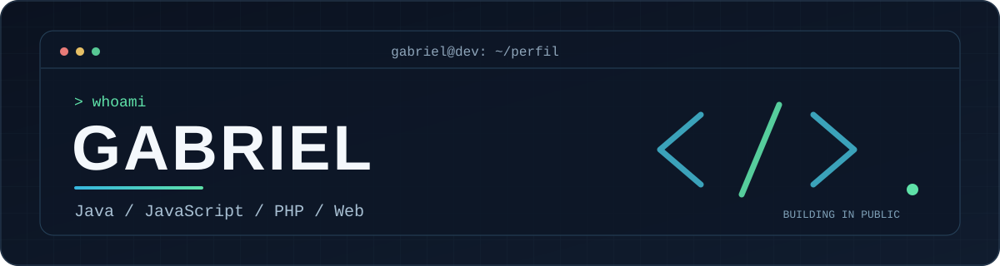

<div align="center">
  
</div>

<br>

<div align="center">

**Desenvolvedor em formação · Java · JavaScript · PHP · Web**

Construindo projetos para transformar estudo em experiência prática.

</div>

## Sobre mim

```text
gabriel@dev:~$ sobre
nome       Gabriel
foco       Desenvolvimento de software e aplicações web
estudando  Java, JavaScript, PHP, HTML e CSS
prática    Projetos acadêmicos e pessoais
```

Gosto de aprender construindo. Meus repositórios reúnem exercícios, interfaces web e aplicações em Java, do primeiro protótipo a projetos com mais regras de negócio.

## Projetos em destaque

| Projeto | O que desenvolvi | Tecnologias |
| :--- | :--- | :--- |
| [Gestão de Barbearia](https://github.com/Gabrielt312/Gestao-de-Barbearia) | Aplicação de terminal para cadastrar clientes, funcionários e serviços, gerenciar agendamentos e gerar um relatório. | Java |
| [Quiz Web Dev](https://github.com/Gabrielt312/Projeto-Game-web---Quiz-Web-Dev) | Quiz interativo sobre desenvolvimento web, com pontuação e resumo das respostas. | HTML, JavaScript, Bootstrap |
| [Pokédex](https://github.com/Gabrielt312/pokedex) | Busca de Pokémon com dados da PokéAPI e navegação entre resultados. [Ver demonstração](https://gabrielt312.github.io/pokedex/). | HTML, CSS, JavaScript |
| [Meu currículo](https://github.com/Gabrielt312/Meu-curriculo) | Página de currículo criada para uma disciplina de desenvolvimento web. | HTML, CSS |

## Tecnologias que uso e estudo

`Java` · `JavaScript` · `PHP` · `HTML` · `CSS` · `Bootstrap`

## Atualmente

- Aprofundando meus estudos em Java e desenvolvimento web.
- Organizando meus projetos para mostrar o problema, a solução e o que aprendi em cada um.

## Vamos conversar

Você pode acompanhar meus projetos e entrar em contato pelo [GitHub](https://github.com/Gabrielt312).
